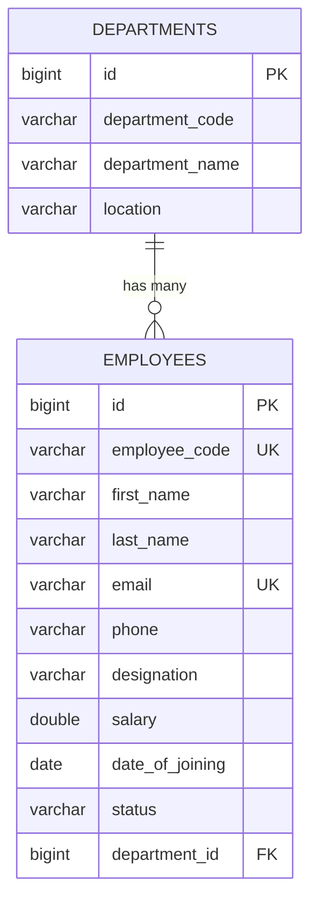
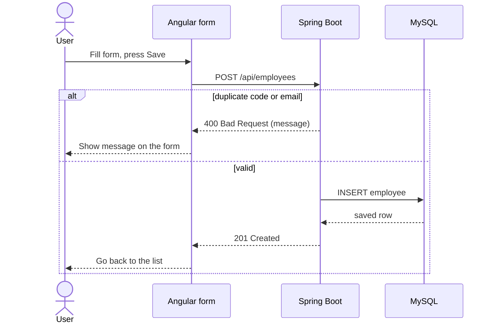

# Employee Management Portal

A full-stack web application for managing an employee directory and assigning each employee to a department. It replaces spreadsheet-based tracking with an Angular interface, a Spring Boot REST API and a MySQL database.

Developed as a lab project for **L&T EduTech**.

| | |
|---|---|
| **Student** | NIKHIL SUNEEL KARJAGI |
| **USN** | 1BM25CD065 |
| **Batch** | CSDS (Batch 2) |
| **Submission date** | 25-10-2026 |
| **Repository** | [github.com/nikhil-karjagi/Employee-Portal](https://github.com/nikhil-karjagi/Employee-Portal) |

## Contents

1. [Problem and Solution](#1-problem-and-solution)
2. [Features](#2-features)
3. [Technologies Used](#3-technologies-used)
4. [Project Structure](#4-project-structure)
5. [Database Design](#5-database-design)
6. [Architecture and Data Flow](#6-architecture-and-data-flow)
7. [CRUD Operations](#7-crud-operations)
8. [REST API](#8-rest-api)
9. [Screenshots](#9-screenshots)
10. [Testing](#10-testing)
11. [Setup and Run](#11-setup-and-run)
12. [Challenges Solved](#12-challenges-solved)
13. [Limitations and Future Improvements](#13-limitations-and-future-improvements)

## 1. Problem and Solution

**Problem:** HR staff who track employees in spreadsheets face duplicate records, slow lookups and no summary view.

**Solution:** a web portal where users can add, search, edit and delete employees, assign each one to a department, and see headline counters on a dashboard.

- **Users:** HR and admin staff
- **Scope:** a single-organisation directory running locally
- **Verified by:** manual test cases (section 10), Postman requests and direct MySQL queries

## 2. Features

- **Dashboard:** metric cards (Total Employees, Active Team, Departments) and an employee table with Edit and Delete buttons.
- **Live search:** filters the loaded list by first name, last name, employee code or designation, with no page reload.
- **One form for Add and Edit:** used at `/employees/new` and `/employees/edit/:id`, pre-filled when editing.
- **Department selection:** the dropdown is filled from `GET /api/departments`.
- **Safe delete:** the browser asks for confirmation before the `DELETE` request is sent.
- **Duplicate protection:** employee code and email are unique in the database. A duplicate is rejected by the API (HTTP 400) and the message is shown on the form.

## 3. Technologies Used

| Layer | Technology | Role in this project |
|---|---|---|
| Frontend | Angular 20 (standalone components, Router, template-driven forms, HttpClient) | Pages, form handling, routing, API calls |
| Markup and style | HTML, custom CSS | Page structure and styling, with no CSS framework |
| Backend | Java 21, Spring Boot 3.5 (Spring Web) | REST controllers and employee business logic |
| Persistence | Spring Data JPA, Hibernate | Maps entities to MySQL tables (`ddl-auto=update`) |
| Database | MySQL 8.0 (`employee_portal_db`, port 3306) | Stores `employees` and `departments` |
| Connectivity | `proxy.conf.json` | Forwards `/api` from port 4200 to `http://localhost:8080` |
| Tools | VS Code, Postman, MySQL Workbench, Git | Development, API testing, database inspection |

React, Bootstrap, H2 and JSON Server were **not** used.

## 4. Project Structure

```
backend/src/main/java/com/example/employeeportal/
  config/        DataSeeder (seeding disabled)
  controller/    EmployeeController, LookupController
  entity/        Employee, Department, Project
  repository/    Spring Data JPA repositories
  service/       EmployeeService
backend/src/main/resources/
  application.yml         activates the "dev" profile
  application-dev.yml     MySQL connection settings
frontend/
  src/app/core/services/employee.service.ts
  src/app/pages/employee-list/    dashboard, metrics, table, search
  src/app/pages/employee-form/    add and edit form
  proxy.conf.json
docs/screenshots/                 evidence images (section 9)
```

## 5. Database Design

### `departments`

| Column | Type | Notes |
|---|---|---|
| `id` | BIGINT | Primary key, auto increment |
| `department_code` | VARCHAR(255) | |
| `department_name` | VARCHAR(255) | Not null |
| `location` | VARCHAR(255) | Optional |

### `employees`

| Column | Type | Notes |
|---|---|---|
| `id` | BIGINT | Primary key, auto increment |
| `employee_code` | VARCHAR(255) | Unique, not null |
| `first_name` | VARCHAR(255) | Not null |
| `last_name` | VARCHAR(255) | Not null |
| `email` | VARCHAR(255) | Unique, not null |
| `phone` | VARCHAR(255) | Optional |
| `designation` | VARCHAR(255) | Optional |
| `salary` | DOUBLE | |
| `date_of_joining` | DATE | |
| `status` | VARCHAR(255) | `ACTIVE`, `ON_LEAVE` or `INACTIVE` |
| `department_id` | BIGINT | Foreign key to `departments(id)` |

**Relationship:** one department has many employees (many-to-one from `Employee` to `Department`).

A `Project` entity (`projects` table: `name`, `client`, `status`) exists as lookup data exposed by `GET /api/projects`. It is not linked to employees and is not used by the UI.

### ER diagram



## 6. Architecture and Data Flow

```
Angular component -> EmployeeService (HttpClient) -> proxy.conf.json
  -> Spring Boot @RestController -> EmployeeService (Java) -> Spring Data JPA -> MySQL
```

### Add Employee flow



## 7. CRUD Operations

| Entity | Create | Read | Update | Delete |
|---|---|---|---|---|
| Employee | Add form, `POST /api/employees` (201) | `GET /api/employees`, `GET /api/employees/{id}` (200) | Edit form, `PUT /api/employees/{id}` (200) | Delete button with browser confirmation, `DELETE /api/employees/{id}` (204) |
| Department | **Not implemented** (rows are added with SQL) | `GET /api/departments` (200) | **Not implemented** | **Not implemented** |

Department create, update and delete are not implemented because departments are treated as lookup data and the project focuses on the Employee workflow.

## 8. REST API

Base URL: `http://localhost:8080/api`

| Method | Endpoint | Description | Status |
|---|---|---|---|
| GET | `/employees` | List all employees | 200 |
| GET | `/employees/{id}` | Get one employee | 200, 404 |
| POST | `/employees` | Create an employee | 201, 400 |
| PUT | `/employees/{id}` | Update an employee | 200, 400 |
| DELETE | `/employees/{id}` | Delete an employee | 204, 404 |
| GET | `/departments` | List departments | 200 |
| GET | `/projects` | List projects (lookup only) | 200 |

## 9. Screenshots

Screenshots are available in the [`docs/screenshots`](docs/screenshots) folder.

## 10. Testing

| ID | Test case | Steps | Expected result | Result |
|---|---|---|---|---|
| TC01 | Create | Fill a valid form, select a department, save | 201 Created; row appears in the list | Pass: Postman `POST /api/employees` returned 201 Created; new row shown in the list |
| TC02 | Read and search | Open the dashboard, type in the search bar | Records load; table filters live | Pass: Postman `GET /api/employees` and `GET /api/employees/{id}` returned 200 OK; search for "anan" showed only the matching employee |
| TC03 | Update | Edit a record and save | 200 OK; updated value shown | Pass: Postman `PUT /api/employees/{id}` returned 200 OK; updated values returned and shown |
| TC04 | Delete | Click Delete and press OK on the prompt | 204 No Content; row removed | Pass: browser confirmation appeared; Postman `DELETE /api/employees/{id}` returned 204 No Content; row removed from the list |
| TC05 | Duplicate input | Save an employee with an existing code or email | Duplicate rejected with an error message | Pass: Postman rejected the duplicate employee code with an error response and message |

## 11. Setup and Run

### Prerequisites

- JDK 21
- Maven (or the Maven wrapper if the project includes one)
- Node.js 20.19 or newer, and npm
- MySQL Server 8.0 (MySQL Workbench optional)

### 1. Database

```sql
CREATE DATABASE employee_portal_db;
```

Tables are created automatically by Hibernate the first time the backend starts. No sample data is included.

### 2. Backend configuration

`application.yml` activates the `dev` profile. The connection settings are in `backend/src/main/resources/application-dev.yml` and read the credentials from environment variables, so no password is stored in the repository:

```yaml
spring:
  datasource:
    url: jdbc:mysql://localhost:3306/employee_portal_db?useSSL=false&allowPublicKeyRetrieval=true&serverTimezone=UTC
    username: ${DB_USERNAME:root}
    password: ${DB_PASSWORD:}
```

Set them in the same terminal before starting the backend (Windows PowerShell):

```powershell
$env:DB_USERNAME = "root"
$env:DB_PASSWORD = "your-mysql-password"
```

### 3. Run the backend

```bash
cd backend
mvn spring-boot:run
```

The API starts at `http://localhost:8080`.

### 4. Add departments

After the first start, add at least one department, because the dropdown reads from the database:

```sql
USE employee_portal_db;
INSERT INTO departments (department_code, department_name) VALUES
  ('ENG', 'Engineering'),
  ('HR', 'Human Resources'),
  ('FIN', 'Finance'),
  ('MKT', 'Marketing');
```

### 5. Run the frontend

```bash
cd frontend
npm install
npx ng serve --proxy-config proxy.conf.json
```

Open `http://localhost:4200`.

## 12. Challenges Solved

- **Wrong import path for `EmployeeService`:** fixed by pointing to `src/app/core/services/employee.service.ts`.
- **`styleUrls` compile error:** shared style variables were moved to the global `styles.css`.
- **Stale build output:** cleared the `.angular` cache and restarted with `npx ng serve`.
- **CORS between ports 4200 and 8080:** solved with `proxy.conf.json`.
- **Duplicate records:** unique constraints on employee code and email, with the error message shown on the form.

## 13. Limitations and Future Improvements

**Limitations:**

- No login or role-based access.
- No pagination; search is client-side and works on the loaded list.
- Departments can only be added with SQL; there is no Department management screen.
- The `Project` entity exists but is not linked to employees.
- Form validation is basic.
- Local use only.

**Future work:** authentication and roles, pagination and server-side search, Department management screens, consistent API error objects (for example 409 for duplicates), automated tests and deployment.
